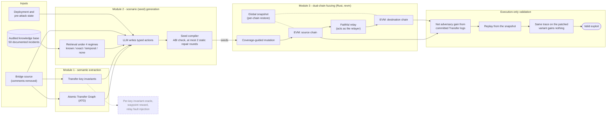
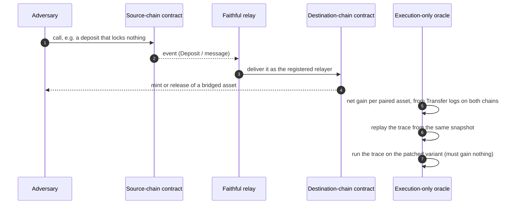
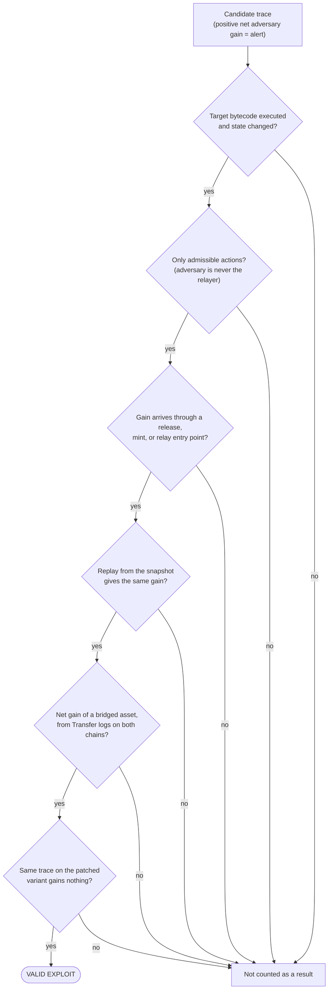
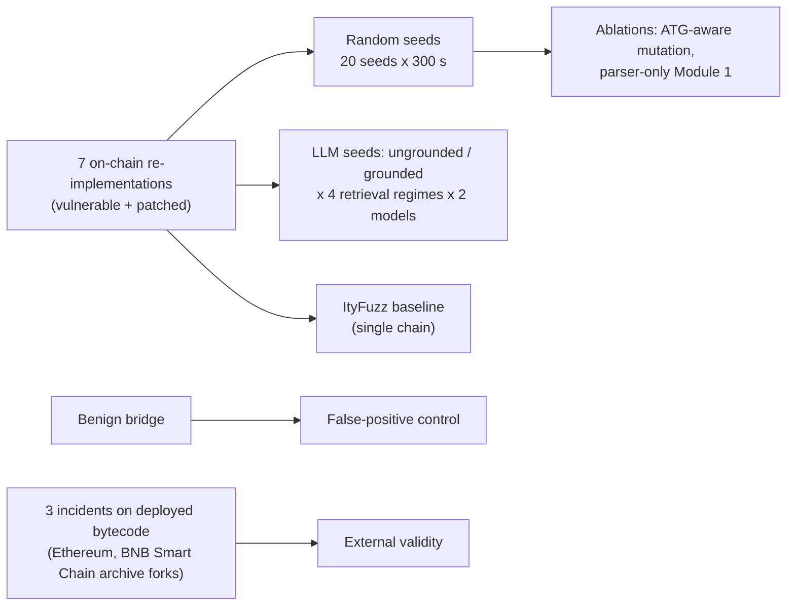

# BridgeSentry

**Detecting Cross-Chain Bridge Vulnerabilities through Dual-Chain Fuzzing and Execution-Validated Exploits**

Research artifact accompanying a manuscript under double-anonymized review. The repository
holds the harness, the benchmark, the seed-generation pipeline, and the raw records of every
campaign reported in the manuscript.

> **In one sentence.** BridgeSentry executes a cross-chain bridge in two Ethereum Virtual
> Machine (EVM) instances joined by a relay, and accepts a transaction sequence as an exploit
> only if the token transfers it commits on both chains show a net gain for the adversary,
> the sequence replays, and it gains nothing on a copy of the bridge in which the documented
> root cause is fixed.

**Scope.** All results concern **documented** incidents. The artifact reconstructs and
validates known exploits under a leakage-controlled protocol; it does **not** claim the
discovery of new vulnerabilities.

---

## Contents

1. [Problem and research gaps](#1-problem-and-research-gaps)
2. [Approach](#2-approach)
3. [The valid-exploit criterion](#3-the-valid-exploit-criterion)
4. [Benchmark](#4-benchmark)
5. [Results](#5-results)
6. [Reproducing the results](#6-reproducing-the-results)
7. [Claim-to-evidence map](#7-claim-to-evidence-map)
8. [Repository layout](#8-repository-layout)
9. [Limitations and threats to validity](#9-limitations-and-threats-to-validity)
10. [Responsible use, citation, and license](#10-responsible-use-citation-and-license)

---

## 1. Problem and research gaps

A cross-chain bridge locks or burns value on a source chain; an off-chain relay attests the
resulting event; a contract on the destination chain mints or releases the corresponding
value. Failures at these seams are among the costliest incidents in decentralized finance.
Testing such a bridge and *showing* that an exploit was reconstructed are different things,
and three gaps separate them:

| Gap | What is missing in current practice | What BridgeSentry provides | Evidence |
| --- | --- | --- | --- |
| **G1. Success criterion** | Bridge-testing tools report alerts that are never checked against code in which the flaw is fixed. Our own earlier oracle flagged all 12 fixtures without executing their code. | A *valid-exploit* criterion computed only from executed token transfers, a replay, and a paired patched variant. | RQ1 |
| **G2. Joint execution** | Single-chain tools cannot deliver a message as the bridge's legitimate relayer, so exploits whose causal path crosses the relay are out of reach. | A dual-EVM harness with a faithful relay, plus execution specifications with patched variants for seven on-chain incidents (2021–2026). | RQ2 |
| **G3. Leakage control** | When a large language model (LLM) writes the initial inputs (seeds), success may reflect what it memorized or retrieved about the target. | Seed generation under four retrieval regimes, mostly on incidents after the model's training cutoff, with a record of everything the model was shown. | RQ3 |

## 2. Approach

### 2.1 Architecture

Solid boxes are the components exercised by the evaluated configuration; dashed boxes are
parts of the full design whose contribution the manuscript does **not** measure.



### 2.2 How an exploit crosses the relay

In four of the seven incidents the documented exploit starts on the source chain and reaches
the destination only through the relay. Executing both chains and the relay in one process is
what makes these reachable.



### 2.3 Evaluated configuration

| Component | In the evaluated configuration |
| --- | --- |
| Two EVM instances (revm), faithful relay, restoration from one global snapshot | Yes |
| Module 2 scenarios (ungrounded or grounded) or 20 random call sequences as seeds | Yes |
| Coverage-guided mutation; ATG-aware mutation | Yes; ATG-aware mutation measured as an ablation (no measurable effect) |
| Adversary-side conservation check, replay, patched-variant control | Yes |
| Per-key authorization and uniqueness invariants as oracle, distance-guided waypoint reward, relay tampering/replay | No (designed, not measured) |

## 3. The valid-exploit criterion

A trace `s` is a **valid exploit** on fixture `F` with patched variant `F'` if (i) it executes
target code and changes state; (ii) it uses only actions admissible under the adversary's
capabilities; (iii) its gain reaches the adversary through a release or mint entry point or
through the relay; (iv) replaying `s` from the same snapshot yields the same gains; (v) the
adversary ends with a **positive net gain of at least one bridged asset, computed from the
token transfers committed on both chains**; and (vi) executing `s` on `F'` yields no such gain.
The harness checks these as seven gates (condition (i) is split into two).



The oracle reads **only committed execution** (Transfer logs, relay deliveries). It never
reads the text of generated scenarios, which is exactly how the earlier oracle failed (RQ1).
Paired assets net a legitimate cross-chain transfer to zero: a source lock offsets the
matching destination mint.

## 4. Benchmark

| Group | Incidents | Role |
| --- | --- | --- |
| **On-chain** (eligible under the criterion) | PolyNetwork (2021), Qubit Finance (2022), Nomad (2022), Ronin bridge (2024), FEG SmartBridge (2024), CrossCurve (2026), Verus–Ethereum (2026)¹ | Execution specification + vulnerable and patched re-implementation + deterministic test of the documented attack |
| **Off-chain** (outside the criterion) | Ronin Network (2022), Harmony Horizon (2022), pGALA (2022), Multichain (2023), Orbit Bridge (2023) | Key or validator compromise; used only in the RQ1 diagnosis |
| **Excluded** | Wormhole (Solana program), Socket Gateway (no cross-chain message), GemPad and FEGtoken (not bridges) | — |
| **Benign control** | A correct lock-mint bridge (`benchmarks/benign_bridge`) | Estimates the false-positive rate on code that is not an exploit |
| **Deployed bytecode** | Nomad, Ronin bridge (2024), Qubit, forked from mainnet archive state | External validity of the criterion |

¹ The non-EVM source chain of Verus is replaced by an EVM surrogate. The PolyNetwork keeper is
modelled as an address.



## 5. Results

Numbers are taken from the manuscript and from the frozen records in `experiments/`
(Section 7). TTVE = time to the first valid exploit; CI = exact 95% Clopper–Pearson interval.
Unless stated otherwise, runs execute local re-implementations on an empty chain state, not
forks of mainnet state.

### RQ1 — Is the success criterion valid?

**The earlier oracle measured the scenario generator, not the exploit.**

| Condition (3 seeds x 20 s per fixture) | Fixtures triggered |
| --- | --- |
| Scenario-derived state, no bytecode executed | 12/12 |
| Bytecode executed, scenario-derived state checked | 11/11 |
| Bytecode executed, execution-derived state only | **0/11** |
| Patched Nomad, scenario-derived state checked | 1/1 (all 18 invariants "violated") |

**The execution-only criterion stays silent on every negative control.**

| Negative control | Runs with an alert |
| --- | --- |
| Patched variants, random seeds, 7 incidents (20 seeds x 300 s) | 0/140 (CI 0–2.6%) |
| Patched variants, random-seed and gpt-oss-120b seed campaigns combined | **0/940** |
| Patched variants, DeepSeek-V3 grounded seeds | 0/400 |
| Patched variants, parser-only Module 1 seeds | 0/100 |
| Independent benign bridge, random + LLM seeds (17.2 M traces) | **0/40** (CI 0–8.8%) |
| Patched deployed bytecode (Nomad, Ronin bridge, Qubit) | 0 in every run |

On the vulnerable variants, every run that raised an alert contained a valid exploit.

### RQ2 — Does dual-chain execution reconstruct exploits that cross the relay?

Both tools are judged by the same criterion (20 seeds x 300 s, vulnerable variant). BridgeSentry
uses **random** seeds here.

| Incident | Exploit path | BridgeSentry valid runs | BridgeSentry median TTVE | ItyFuzz valid runs | Gate for the single-chain fuzzer |
| --- | --- | --- | --- | --- | --- |
| PolyNetwork | Relay | 1/20 | > 300 s | 0/20 | Caller must be the keeper |
| Qubit Finance | Relay | 20/20 | 0.18 s | 0/20 | Caller must be the relayer |
| FEG SmartBridge | Relay | 16/20 | 72.3 s | 0/20 | Caller must be the relayer |
| Verus–Ethereum¹ | Relay | 20/20 | 1.06 s | 20/20 | Over-claim on a committed export |
| Nomad | Destination | 20/20 | 0.0022 s | 20/20 | Unpermissioned release |
| Ronin bridge (2024) | Destination | 20/20 | 0.011 s | 20/20 | Unpermissioned release |
| CrossCurve | Destination | 20/20 | 0.19 s | 0/20 | Structured ABI payload |

The three incidents the single-chain fuzzer misses for lack of identity are exactly those
whose exploit must be carried across the relay by its legitimate operator. With grounded seeds
(RQ3), BridgeSentry reconstructs PolyNetwork and FEG SmartBridge in **20/20** runs as well.
BridgeFuzz (EuroSec 2026) fuzzes its own prototype bridge and raises balance alerts without a
patched-variant control; it is compared at the level of the criterion, not as a same-fixture
baseline.

### RQ3 — Do LLM-generated seeds help, and is it leakage?

gpt-oss-120b (stated training cutoff June 2024), 20 seeds x 300 s per cell. Regimes: **Known**,
full knowledge base; **Exact**, the target's records removed; **Temp.**, only records dated
before the target; **None**, no retrieval. Ronin bridge (2024), FEG SmartBridge, CrossCurve,
and Verus–Ethereum post-date the cutoff.

| Incident | Random | Ungrounded: Known / Exact / Temp. / None | Grounded: Known / Exact / Temp. / None |
| --- | --- | --- | --- |
| PolyNetwork — valid runs | 1 | 1 / 0 / 0 / 0 | **20 / 20 / 20 / 20** |
| PolyNetwork — median TTVE | > 300 s | > 300 s in every regime | 2.25 / 2.05 / 1.14 / 0.034 s |
| FEG SmartBridge — valid runs | 16 | 10 / 17 / 14 / 13 | **20 / 20 / 20 / 20** |
| FEG SmartBridge — median TTVE | 72.3 s | > 300 / 90.8 / 149.9 / 181.9 s | 0.0011 / 0.0033 / 0.0028 / 0.0011 s |
| Ronin bridge (2024), CrossCurve, Verus–Ethereum | 20 | 20 in every regime | 20 in every regime |

- **Ungrounded** seeds, whose prompt contained no code of the target (only the graph and
  invariants of Module 1), did **not** outperform random seeds.
- **Grounded** seeds, whose prompt contained the comment-free source, the ABIs, and the
  deployment, found a valid exploit in **all 400 runs** on the five incidents, including with
  no retrieval at all. Retrieving the target's own record shortened the search by at most
  **2.2 ms**. The grounded configuration was designed after the ungrounded result and
  registered before its seeds were generated (`docs/C3b_protocol.md`).
- **Second model.** DeepSeek-V3 reproduces the result: every incident is solved under every
  regime, 0/400 patched alerts. Its PolyNetwork rate is 20/20 with the target's record and
  13–16/20 without it.
- **Parser-only Module 1** (no LLM in extraction) matches the LLM Module 1 in all 20 runs on four of
  the five incidents. It differs only on PolyNetwork (1/20 vs 20/20), the one incident before the
  cutoff, where memorization cannot be excluded. Where the LLM helps is in writing the exploit,
  not in extraction.

### External validity — deployed bytecode

| Incident | Forked state | Adversary gain (vulnerable) | Runs (vulnerable / patched) |
| --- | --- | --- | --- |
| Nomad (2022) | Ethereum mainnet archive | 100 WBTC | 3/3 valid · 0/3; robustness 10/10 grounded, **10/10 random**, 0/10 patched |
| Ronin bridge (2024) | Ethereum mainnet archive | 1,998,046 USDC | 3/3 valid · 0/3; robustness 10/10 grounded, **10/10 random**, 0/10 patched |
| Qubit (2022) | Ethereum **and** BNB Smart Chain archives | 190 qXETH on the destination chain, via the relay | 3/3 valid · 0/3 |

No contract is compiled or redeployed: the fork loads each account's real bytecode and storage
on demand. Random seeds reconstruct the exploits without the recorded calldata, so the harness
searches the deployed code rather than only replaying it.

### Ablations and controls

| Experiment | Result |
| --- | --- |
| **ATG-aware mutation** on/off (FEG SmartBridge, PolyNetwork; random seeds) | 16/20 vs 16/20 (Fisher p = 1.0; log-rank p = 0.68) and 0/20 vs 1/20 (p = 1.0). No measurable effect at this sensitivity: on FEG even 20/20 would give only p = 0.11, and PolyNetwork would need at least 5/20 to reach significance. The operator chooses *which* call to insert; both exploits hinge on the *content* of an encoded message. |
| **Benign bridge, asset pairing removed** | The same legitimate transfer reports a 190-token gain, so the bridge does move value and the cross-chain pairing is what nets it to zero. |
| **Source-chain reorganization** (per-chain snapshot primitive) | Synchronized execution of a legitimate transfer: no gain. After a source reorganization that drops the source-committed transfers: an unbacked **190-token** release. A global snapshot cannot represent this state. Shown by a deterministic test (`benign_bridge_source_reorg_leaves_release_unbacked`). |

### Cost of seed generation

Estimated from recorded token counts at OpenRouter list prices (28 November 2026); latency
includes the network time to the service.

| Seed configuration | Seed sets | Tokens per set | Est. cost (USD) | Median end-to-end latency per set | First responses rejected by the seed compiler |
| --- | --- | --- | --- | --- | --- |
| Ungrounded gpt-oss-120b | 20 | 62,513 | 0.12 | not recorded | — |
| Grounded gpt-oss-120b | 20 | 134,800 | 0.45 | 240 s | 48/349 (all fixed by one repair round) |
| Grounded DeepSeek-V3 | 20 | 50,280 | 0.37 | 173 s | 10/271 (6 not fully compiled) |
| Grounded, parser-only Module 1 | 5 | 16,432 | 0.01 | 33 s | 3/15 (all fixed) |

All seed sets behind the reported results cost about **US$0.95**.

## 6. Reproducing the results

### 6.1 Requirements

| Tool | Version | Used for |
| --- | --- | --- |
| Rust toolchain | 1.97 or later (reported builds: 1.97.0, 1.99.1, 1.100.0) | Module 3 fuzzer |
| `solc` | **0.8.20 exactly**, on `PATH` | Compiling the fixtures at run time; the fixture tests refuse any other version |
| Python | 3.10 or later | Orchestration, seed generation; the campaign runners use only the standard library |
| Slither (optional) | 0.11 | Parser-based Module 1 |
| Archive JSON-RPC endpoints (Ethereum, BNB Smart Chain) | — | Only for the deployed-bytecode forks |
| OpenRouter API key | — | Only for regenerating LLM seeds (the seed sets used are committed) |

```bash
pip install -r requirements.txt
cp .env.example .env          # API keys and RPC URLs; never commit this file
```

### 6.2 Build and test

```bash
cd src/module3_fuzzing
cargo build --release
cargo test --release          # expected: all tests pass with solc 0.8.20 on PATH
```

Every official fixture has a deterministic test that replays the documented attack and checks
all seven gates on the vulnerable variant and no gain on the patched one. A different `solc`
makes these tests fail; `BRIDGESENTRY_ALLOW_MISSING_SOLC=1` skips them and marks them as
*not evidence*.

For cluster runs, build a statically linked binary
(`cargo build --release --target x86_64-unknown-linux-musl`) on a build host; see
`scripts/official/README.md`.

### 6.3 Run one fixture

```bash
# terminal 1: an empty chain state (local fixtures, NOT a mainnet fork)
python3 scripts/official/empty_rpc.py 18545

# terminal 2: one run = <bench> <vulnerable|patched> <llm|random> <seed> <budget_s>
RPC_URL=http://127.0.0.1:18545 \
  scripts/official/run_official.sh qubit vulnerable random 1042 60
```

The result JSON reports `valid_exploits`, `candidates_total`, `first_valid_exploit_s`, the
seven gates of each candidate, coverage, and the seed source actually used. On `patched`, the
same command must report no candidate.

### 6.4 Campaigns

```bash
# {vulnerable, patched} x {llm, random} x $SEEDS, then aggregate to summary_official.csv
SEEDS="1042 2042 3042 4042 5042" \
  scripts/official/run_matrix.sh experiments/official_<YYYYMMDD> 300 4 nomad qubit
```

| Environment variable | Meaning |
| --- | --- |
| `BRIDGESENTRY_EVALUATION_MODE=official` | Execution-only oracle. **Required for every reported number**; the legacy oracle is kept only to reproduce RQ1. |
| `BRIDGESENTRY_OFFICIAL_VARIANT` | `vulnerable` or `patched` |
| `BRIDGESENTRY_OFFICIAL_SEEDS` | `llm` (Module 2 scenarios) or `random` (20 random call sequences) |
| `BRIDGESENTRY_OFFICIAL_STRICT_SEEDS=1` | An `llm` run whose scenarios map to no fixture call fails instead of silently using random seeds |
| `BRIDGESENTRY_OFFICIAL_SPEC` | Specification file under `benchmarks/<b>/official/` (default `spec.json`; `spec_onchain.json` for forks) |
| `BRIDGESENTRY_ATG_MUTATION=1` | Enables ATG-aware mutation (ablation) |
| `BRIDGESENTRY_OFFICIAL_REORG=source` | Runs the source-reorganization demonstration and exits |

### 6.5 Seed generation (optional; committed seed sets are used by default)

```bash
export OPENROUTER_API_KEY=...                    # from .env
export OPENROUTER_BASE_URL=https://openrouter.ai/api/v1
export OPENROUTER_MODEL=openai/gpt-oss-120b      # or deepseek/deepseek-chat
python3 scripts/official/generate_seeds.py --model gpt-oss-or \
  --bench polynetwork --regime no_rag --grounded \
  --deploy-log <deploy log of a random-seed run> --ledger ledger.csv
# --parser-only : Module 1 without an LLM;  --regime known|exact|temporal|no_rag
```

Seed sets are written to `benchmarks/<b>/official/llm_outputs/<alias>/<regime>/` with a
`provenance.json` recording the model, temperature, retrieved and removed knowledge-base
entries, the artifacts shown to the model, token usage, and every compiler repair round.
The service routes requests to upstream providers, so regenerated seeds may differ.

### 6.6 Deployed-bytecode forks

```bash
BRIDGESENTRY_EVALUATION_MODE=official BRIDGESENTRY_OFFICIAL_SPEC=spec_onchain.json \
BRIDGESENTRY_OFFICIAL_VARIANT=vulnerable BRIDGESENTRY_OFFICIAL_SEEDS=llm \
src/module3_fuzzing/target/release/bridgesentry-fuzzer \
  --atg benchmarks/qubit/llm_outputs/atg.json --scenarios benchmarks/qubit/llm_outputs/hypotheses.json \
  --metadata benchmarks/qubit/metadata.json --output out.json --budget 90 --runs 1 --seed 1042 \
  --source-rpc "$ETH_ARCHIVE_RPC" --dest-rpc "$BSC_ARCHIVE_RPC" \
  --source-block 14090169 --dest-block 14738000
```

A failed RPC connection makes the harness fall back to a synthetic state, which the
on-chain mode rejects; check the log for `fallback to synthetic` before using a run.

## 7. Claim-to-evidence map

Each directory under `experiments/` is a frozen record (raw JSON and logs, summary, scripts,
`REPORT.md` with commit, binary hash, toolchain, and hardware). Records are never edited after
commit; `experiments/README.md` indexes them and marks superseded ones.

| Claim in the manuscript | Record(s) |
| --- | --- |
| RQ1: the earlier oracle triggers without executing code | `legacy_oracle_diagnosis_20261103/` |
| RQ1: first three execution-only rounds (Nomad, Qubit) | `official_20261103/`, `official_20261103_r2/`, `official_20261106_hpc_regression/` |
| RQ1/RQ2: seven incidents, random seeds, 0/140 patched | `official_20261114_a1_hpc/` |
| RQ1: benign bridge, 0/40 | `official_20261128_benign_bridge/` |
| RQ2: ItyFuzz under the same criterion | `official_20261120_ityfuzz_hpc/` |
| RQ2: BridgeFuzz criterion comparison | `baseline_bridgefuzz_20261123/` |
| RQ3: ungrounded seeds, four regimes | `official_20261115_c3_hpc/` |
| RQ3: grounded seeds (protocol, generation, positive control, campaign) | `docs/C3b_protocol.md`, `official_20261118_c3b_seedgen/`, `official_20261118_seed_channel_control/`, `official_20261118_c3b_hpc/` |
| RQ3: second model (DeepSeek-V3) | `official_20261124_deepseek_seedgen/`, `official_20261124_deepseek_hpc/` |
| RQ3: parser-only Module 1 | `official_20261126_a5_parser_only_seedgen/`, `official_20261126_a5_parser_only_hpc/` |
| External validity: deployed bytecode | `official_20261122_onchain_nomad/`, `official_20261124_onchain_ronin/`, `official_20261126_onchain_fork_robustness/`, `official_20261126_onchain_qubit/` |
| ATG-aware mutation ablation | `official_20261123_atg_ablation/` |
| Source-chain reorganization | `official_20261128_reorg/` |
| Cost and latency of seed generation | `official_20261128_a8_cost_latency/` |
| Fixture classification and knowledge-base audit | `docs/official_fixture_classification.md`, `docs/kb_audit.md` |

## 8. Repository layout

```
.
├── src/
│   ├── module1_semantic/     # Module 1: ATG and invariant extraction (LLM or Slither/regex parser)
│   ├── module2_rag/          # Module 2: knowledge base (data/), retrieval, grounding, scenario generation
│   ├── module3_fuzzing/      # Module 3 (Rust): dual EVM, relay, snapshots, mutation,
│   │   └── src/official_mode.rs  #   execution-only oracle, seven gates, fixture tests
│   └── common/               # LLM client, generation provenance, schema validation
├── benchmarks/<incident>/
│   ├── metadata.json         # incident metadata and sources
│   ├── official/             # spec.json (+ spec_onchain.json), vulnerable/ and patched/ Solidity
│   └── llm_outputs/          # Module 1-2 outputs; official/llm_outputs/<alias>/<regime>/ seed sets
├── scripts/official/         # canonical runners: run_official.sh, run_matrix.sh, empty_rpc.py,
│                             #   generate_seeds.py, aggregate/analyze scripts, cluster job scripts
├── experiments/              # frozen records of every campaign (see Section 7)
├── baselines/                # baseline harnesses (ItyFuzz) and earlier baseline work not in the manuscript
├── schemas/                  # JSON schemas for ATG, hypotheses, invariants, results
├── tests/                    # Python tests (provenance, manifests, knowledge base)
└── docs/                     # protocols, fixture classification, knowledge-base audit, guides
```

## 9. Limitations and threats to validity

- **Known incidents only.** Every incident is documented, so the results do not measure the
  discovery of unknown vulnerabilities.
- **Re-implementations.** Four of the seven incidents are evaluated only as minimal
  re-implementations of the root cause on an empty chain state. Three are additionally
  reconstructed on deployed bytecode. Short fixtures favour both the fuzzer and a model that
  reads the whole contract.
- **Seed design after observation.** Grounded generation was designed after the ungrounded
  campaign on the same five incidents; it was registered before generation, but no further
  incident was held out to test it.
- **Memorization.** PolyNetwork predates the models' stated cutoff. Both models share a
  cutoff of about mid-2024, so the second model confirms the result without extending the
  temporal holdout.
- **Oracle scope.** The criterion detects exploits that move bridged value to the adversary;
  an authorization or uniqueness violation with no net gain is missed. Off-chain key
  compromises are outside it.
- **Controls.** The false-positive estimate rests on the patched variants and one benign
  bridge, not on a broad sample of production code. The reorganization result demonstrates
  the mechanism, not a reorganization-driven exploit of a documented incident.
- **Timing.** Fork runs are dominated by archive round-trips over a residential link and are
  reported only to show termination. Absolute times of the earliest rounds are indicative.

## 10. Responsible use, citation, and license

**Responsible use.** The fixtures re-implement exploits that are publicly documented and
patched; the deployed-bytecode runs execute on local forks of historical state and send no
transaction to any live network. Do not use the harness against systems you are not
authorized to test.

**Citation.** The manuscript is under double-anonymized review; please cite it as

```bibtex
@unpublished{bridgesentry2026,
  title  = {BridgeSentry: Detecting Cross-Chain Bridge Vulnerabilities through
            Dual-Chain Fuzzing and Execution-Validated Exploits},
  note   = {Manuscript under review},
  year   = {2026}
}
```

**License.** No license file has been added yet; until one is, all rights are reserved by the
authors.
